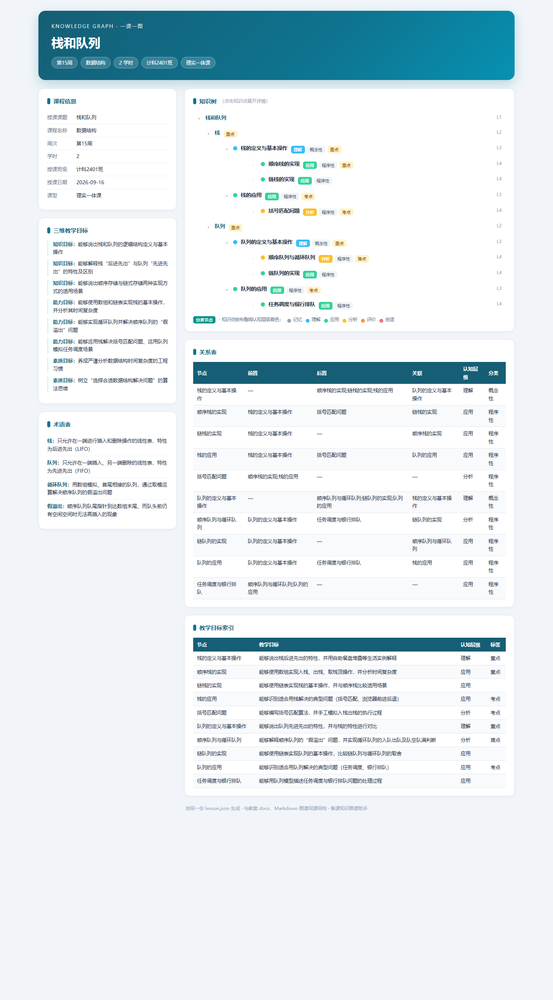
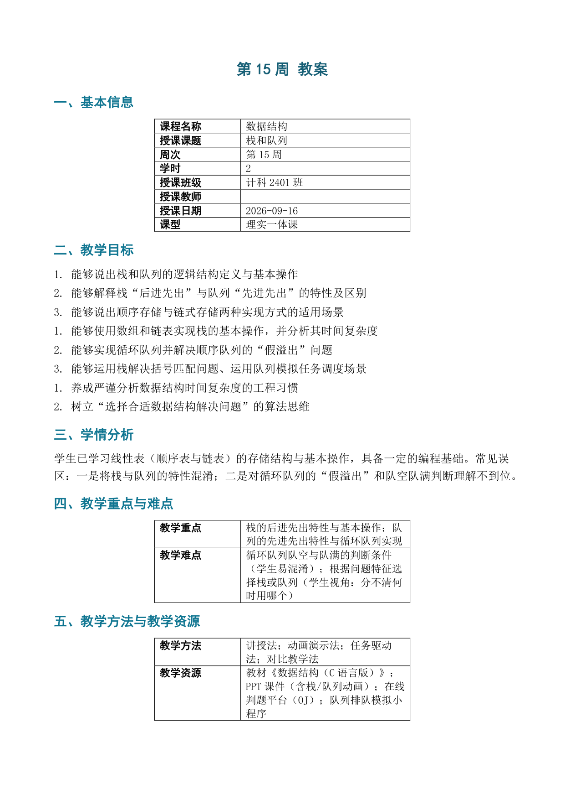

# 教研备课图谱工坊 · Lesson Plan Assistant

> 一份输入，三件产出——备一次课，沉淀一套课程知识资产。

输入「周次 + 课题 + 要点」（或教材 / 课标 / PPT 文本），一键锻造三件套：

| 产物 | 说明 | 用途 |
|------|------|------|
| `第X周_教案.docx` | 标准教案：三维目标 / 学情 / 重难点 / 课前课中课后 | 填好即可直接上交 |
| `第X周_知识图谱.md` | 知识树 + 关系表 + 教学目标索引 + 术语表 | 可审阅、可版本管理 |
| `第X周_知识图谱.html` | 交互式「一课一图」信息图 | 演示、课件、打印，离线可用 |



**核心设计：一份 `lesson.json` 同源驱动三件套**——教案里讲的知识点 = 图谱里的节点，由硬校验红线保证，从机制上杜绝「教案和图谱对不上」。

## 它解决什么问题

教师备课的真正痛点不是「写不出教案」，而是：

- **对不上**：教案、知识图谱各写各的，知识点互相脱节
- **会漂移**：每次风格不一样，这周写的和上周不像同一个人写的
- **反复改**：格式要手动套模板，返工耗时
- **留不下**：备完就扔，课程知识无法沉淀复用

本项目的答案：LLM 只负责教学结构化（产出符合契约的 `lesson.json`），**确定性逻辑全部下沉到脚本层**——渲染、校验、风格一致，交给代码而不是靠模型自觉。

## 效果展示

### 交互式知识图谱（HTML，离线单文件）

知识树可折叠、知识点按布鲁姆认知层级着色（记忆→创造六级配色）、点击查看教学目标详情，零外部依赖。

### 标准教案（docx）



五环节课堂时间轴（导入→新授→新授→互动练习→小结作业）× 四维（内容 / 学生活动 / 教师活动 / 设计意图），三维目标用行为动词可衡量。

### 示例

| 示例 | 说明 |
|------|------|
| [`examples/stack_queue`](examples/stack_queue) | 高校《数据结构》· 第 15 周「栈和队列」，标准风格 |
| [`examples/ai_training`](examples/ai_training) | 企业 AI 培训 · 3 天 12 模块，标准风格 |
| [`examples/ai_generative_art`](examples/ai_generative_art) | 「人工智能生成艺术」第 1 章导论，教师风格档案驱动 |

每个示例含 `lesson.json` 与三件套成品，可直接打开体验。

## 快速开始

```bash
git clone https://github.com/longkinght/lesson-plan-assistant.git
cd lesson-plan-assistant

# 安装依赖（仅一个）
pip install python-docx

# 用示例跑通全流程
python scripts/lesson_assistant.py \
  --json examples/stack_queue/lesson.json \
  --output-dir output
```

输出（`output/` 下）：

```text
✅ 硬校验通过 → 第15周_知识图谱.md → 第15周_知识图谱.html → 第15周_教案.docx
```

## 使用方式

### 方式一：交给 AI Agent（推荐）

本仓库同时是一个标准 [Agent Skill](SKILL.md)。在千问办公等支持 Skill 的 AI 工作台里安装后，直接说：

> 「帮我备第 15 周的课，栈和队列，要点：顺序栈、链栈、循环队列、括号匹配」

Agent 会走完整工作流：教学结构化 → 17 项备课质检 → 自动生成三件套，硬红线不通过不交付。

### 方式二：命令行手动使用

```bash
# 1. 编写 lesson.json（字段规范见 references/lesson-json-schema.md，
#    或直接复制 examples/ 下的模板改）
# 2. 一键生成三件套
python scripts/lesson_assistant.py --json lesson.json --output-dir 输出目录

# 教师风格档案驱动（输出与历史教案同风格）
python scripts/lesson_assistant.py --json lesson.json --output-dir 输出目录 \
  --style teacher-zhang
```

各脚本也可单独使用：

```bash
python scripts/verify_consistency.py --json lesson.json   # 只做硬校验
python scripts/build_graph.py --json lesson.json --output 知识图谱.md
python scripts/render_html.py  --json lesson.json --output 知识图谱.html
python scripts/build_lesson_docx.py --json lesson.json --output 教案.docx
```

## 硬校验红线（不通过即阻止交付）

- 教案课中环节引用的知识点 **必须存在于** 图谱节点（同源一致性）
- 知识树层级连续无断层、节点名唯一、前置/后置/关联引用精确匹配
- Level ≥ 4 的知识点必须绑定布鲁姆认知层级 + 可衡量的教学目标
- 分类节点不得挂知识属性；被降级/删除的候选知识点记入 `rejected-notes.md`，不静默丢弃

## 设计要点

- **学生视角三问**：每个知识点问——课标有依据吗？能写可衡量目标吗？学生真的需要学吗？
- **布鲁姆绑定**：知识点按记忆 / 理解 / 应用 / 分析 / 评价 / 创造六级标注，目标全部用行为动词
- **易错点写认知误区**：如「栈后进先出 vs 队列先进先出易混淆」，不写「内容难」
- **教师风格档案**：提供历史教案后提炼为 `teacher-style.json`，渲染器按档案输出，成品与你的习惯一致
- **跨周沉淀**：`lesson.json` 与术语表逐周归档，累积成课程级知识资产

## 目录结构

```text
lesson-plan-assistant/
├── SKILL.md                     # Agent Skill 定义（工作流与纪律）
├── skill.json                   # 技能元数据
├── references/                  # JSON 契约 / 抽取规则 / 17 项质检清单 / 风格档案
├── scripts/                     # 主入口 + 校验 + 三件套渲染器
├── templates/                   # HTML 信息图模板（单文件离线）
├── examples/                    # 三个完整示例（含 lesson.json 与成品）
└── docs/                        # 展示截图
```

## 环境要求

- Python 3.8+
- 唯一依赖：`pip install python-docx`

## License

MIT
