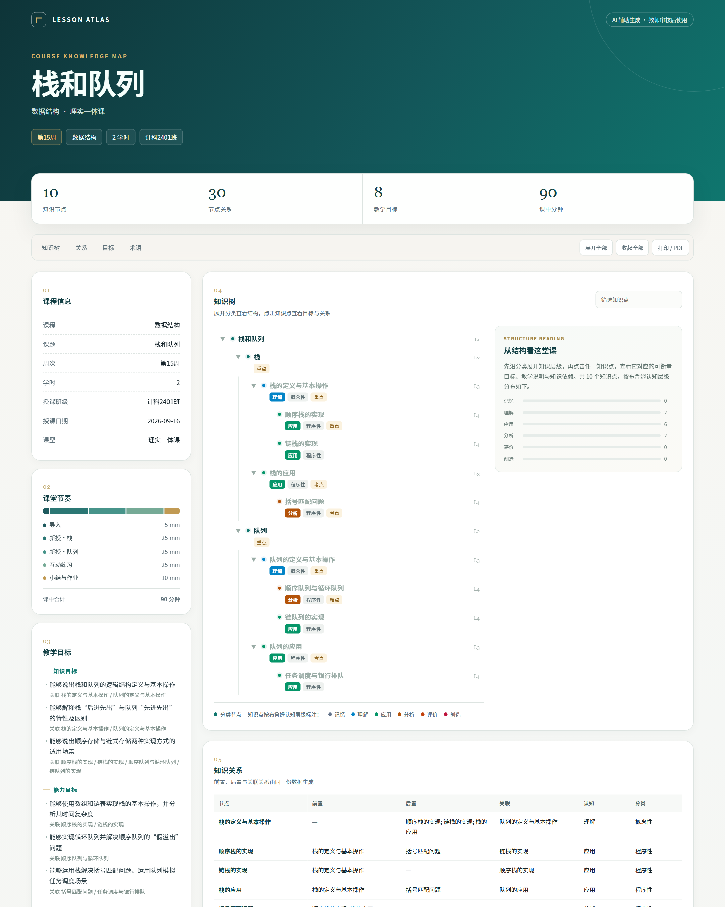
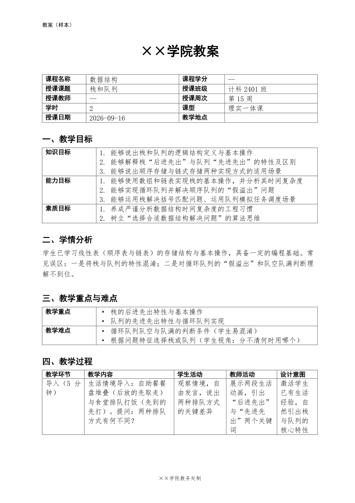

# Lesson Atlas · 备课知识图谱助手

> 作者：黄彬 · MIT License · © 2026

把一节课的教学设计整理成一份结构化数据，再同源生成可编辑教案、知识图谱和离线课程看板。



这不是“让模型直接写一篇教案”。它把教学内容和交付格式拆开：

- 模型只负责教学结构化；
- 脚本负责契约校验、DOCX/Markdown/HTML 渲染和成品一致性验收；
- 教师只需审核内容，不再处理格式与对齐。

**生成的是可编辑教案初稿，不是无需复核即可上交的学校定稿。**

## 三件产物

| 文件 | 内容 | 适合场景 |
|---|---|---|
| `<周次>_<课题>_教案.docx` | 封面、三维目标、学情、重难点、四维课堂表、反思占位、知识结构附录 | 教师修改、教研审阅、打印提交前排版 |
| `<周次>_<课题>_知识图谱.md` | 知识树、课堂时间轴、关系表、目标映射、节点目标、术语表 | 版本管理、教研协作、课程资产沉淀 |
| `<周次>_<课题>_知识图谱.html` | 可折叠知识树、节点解读、认知分布、关系与目标表、打印样式 | 演示、课件、教师培训、离线分享 |

HTML 是单文件，不加载 CDN、外部字体或在线图片。直接双击即可打开，可用浏览器打印为 PDF。

## v2 做了什么

相对初版，这一版补齐了公开分享所需的可用性与边界：

- 教学目标改为对象结构，必须绑定具体知识点；
- 每个知识点都要求可观察目标，不再只看层级；
- 五环节、四维、课堂总时长进入硬校验；
- 教学反思区分 `pre_class` 与 `post_class`，禁止把备课预案写成课堂结果；
- 所有异常输入都能返回字段级错误，不抛 traceback；
- 先生成到临时目录，三件都成功后再原子替换正式文件；
- 输出文件名包含周次和课题，清理非法字符与路径穿越片段；
- 教师风格改为通用配置，公共版本不包含真实学校或教师默认值；
- HTML 增加真正可折叠的知识树、搜索、节点解读、移动端适配和打印样式；
- DOCX 统一封面、信息网格、四维表、页眉页脚与附录版式；
- 新增 21 项自动化测试，可选中浏览器交互测试。

### v2.1 模板通道

学校有规定版式时，不再只能套内置模板：

- 上传学校样本 DOCX，脚本解析出“字段 → 格子”的候选映射并生成核对报告；
- 教师核对一次，映射存成 `template-map.json`，同校同模板长期复用；
- 填充时复用样本 run 级格式，字体、字号、行距、边框、底纹、页眉页脚、页面设置全部继承；
- 课中环节表按内容自动增减行，`备注`类表尾行不动；
- 严格模式下不追加附录、不加页眉页脚说明，只写样本已有位置；
- 新增 16 项模板测试，覆盖格式保留、行增删、跨页选项、地址越界与配置错误。

完整变更见 [`CHANGELOG.md`](CHANGELOG.md)。

## 质量门

### 数据与一致性

- 单一 Level 1 根节点，层级连续，节点名唯一；
- 分类节点不挂知识属性；
- `pre`、`post` 只引用真实知识点；
- 每条目标绑定真实知识点；
- 课中引用必须存在，且必须是知识点而非分类；
- 课中时长合计 = 学时 × 每学时分钟数。

### 课堂设计

- 默认五环节：导入 → 新授一 → 新授二 → 互动练习 → 小结作业；
- 每环节必须填写教学内容、学生活动、教师活动、设计意图；
- 导入外环节建议声明知识点；
- 未进入课堂的知识点会给出提醒。

### 真实性

- 备课阶段反思三段必须含“待课后填写”；
- 课后反思建议提供 `evidence` 来源；
- 示例中的课堂数据不能自动复制到新教案；
- 不编造教材章节、课标条目或学生结果。

## 快速开始

环境：Python 3.8+。

```bash
pip install -r requirements.txt

python scripts/lesson_assistant.py \
  --json examples/stack_queue/lesson.json \
  --output-dir output
```

当前示例的输出：

```text
output/
├── 第15周_栈和队列_教案.docx
├── 第15周_栈和队列_知识图谱.md
└── 第15周_栈和队列_知识图谱.html
```

只校验：

```bash
python scripts/verify_consistency.py --json examples/stack_queue/lesson.json
```

校验并生成，再用独立脚本回读验收：

```bash
python scripts/lesson_assistant.py --json examples/stack_queue/lesson.json --output-dir output
python scripts/audit_artifacts.py --json examples/stack_queue/lesson.json --output-dir output
```

## 作为 Skill 使用

把整个目录复制到 WorkBuddy 用户 Skill 目录：

```text
~/.workbuddy/skills/hb-lesson-plan-assistant/
```

重启会话后，可以直接说：

> 帮我备第 15 周的课，数据结构，课题是栈和队列，2 学时，要点是顺序栈、链栈、循环队列和括号匹配。

Skill 会按以下顺序执行：

1. 收集缺失输入；
2. 读取 JSON 契约与抽取规则；
3. 生成 `lesson.json`；
4. 运行质量校验；
5. 生成三件套；
6. 回读验收；
7. 汇报推断项、提醒项和教师复核清单。

安装说明与命令都写在 [`SKILL.md`](SKILL.md)。

## 三种使用方式

### 一句话备课

交给支持 Skill 的 AI 工作台，提供课题、周次、学时、教学对象和要点。适合第一次建课。

### 手动编辑 lesson.json

从 `examples/` 复制最接近的示例，修改后运行：

```bash
python scripts/lesson_assistant.py --json lesson.json --output-dir output
```

适合已有课程资产、需要严格控制内容的场景。

### 只生成某种格式

```bash
python scripts/build_graph.py       --json lesson.json --output 知识图谱.md
python scripts/render_html.py       --json lesson.json --output 知识图谱.html
python scripts/build_lesson_docx.py --json lesson.json --output 教案.docx
```

## 章节模板

默认使用标准课时教案。需要章节制版式时：

```bash
python scripts/lesson_assistant.py \
  --json examples/ai_generative_art/lesson.json \
  --output-dir output \
  --style chapter
```

自定义字段与封面：

```bash
python scripts/lesson_assistant.py \
  --json lesson.json \
  --output-dir output \
  --style-config references/teacher-style.json
```

配置文件说明见 [`references/teacher-style-profile.md`](references/teacher-style-profile.md)。

## 按学校样本生成（模板通道）

有的学校对教案 Word 有硬性版式规定。这时不要让脚本“模仿得像”，而是直接用学校样本当模板：

```bash
# 1. 解析样本：产出 <样本名>_template-map.json 与 <样本名>_template-report.md
python scripts/analyze_template.py \
  --template examples/school-template/学校样本_教案模板.docx \
  --out-dir examples/school-template

# 2. 核对映射，把 confirmed 改为 true

# 3. 按样本格式生成三件套
python scripts/lesson_assistant.py \
  --json examples/stack_queue/lesson.json \
  --output-dir output \
  --template examples/school-template/学校样本_教案模板.docx \
  --template-map examples/school-template/学校样本_教案模板_template-map.json
```

示例目录里已有一份完整的演示：`examples/school-template/`，包含样本、映射、核对报告和按该样本生成的成品。

下面是按该样本填出的第 1 页（仿宋 12pt 正文、黑体表头、2.5cm 页边距、页脚均为样本原有设置）：



**保留机制**：写入时复用原 run 的 `w:rPr`，多行内容按原段落复制，表格行用深拷贝，页眉页脚、页面设置、`styles.xml` 完全不改。测试会逐项断言字体仍是样本的仿宋 12pt、表头仍是黑体、页边距未变、页脚文字未被替换。

样本既可以是空白模板，也可以是已填好的参考教案。脚本会自动区分三种结构：一张表多行（行克隆/裁剪）、每个环节一张独立小表（整组配对/克隆/删除）、教学目标写成编号段落（整段区间替换）。

**边界**：第一次必须人工确认映射，不承诺零配置适配任意样本；超长内容会撑开行高，无法与原样本逐像素一致；rows 模式下一个表只对应一个区块。完整说明见 [`references/template-mapping.md`](references/template-mapping.md)。

## 数据契约

最小结构：

```json
{
  "schema_version": "2.0",
  "lesson_meta": { "week": "第15周", "title": "栈和队列", "course_name": "数据结构", "hours": 2 },
  "objectives": {
    "knowledge": [{ "text": "能够说出栈与队列的区别", "knowledge_refs": ["栈的定义与基本操作"] }],
    "ability": [{ "text": "能够实现循环队列", "knowledge_refs": ["顺序队列与循环队列"] }],
    "quality": [{ "text": "养成先分析再实现的工程习惯", "knowledge_refs": ["顺序栈的实现"] }]
  },
  "knowledge_tree": [],
  "flow": { "structure": "five_stage", "in_class": [] },
  "reflection": { "status": "pre_class" }
}
```

完整字段、时长公式、环节角色和迁移方法见 [`references/lesson-json-schema.md`](references/lesson-json-schema.md)。

## 示例

| 示例 | 说明 |
|---|---|
| [`stack_queue`](examples/stack_queue) | 高校数据结构，2 学时标准教案 |
| [`ai_training`](examples/ai_training) | 企业 AI 培训，3 天 16.5 学时工作坊 |
| [`ai_generative_art`](examples/ai_generative_art) | 人工智能生成艺术，章节模板示例 |
| [`school-template`](examples/school-template) | 学校空白样本（一张表多行）+ 映射 + 核对报告 + 成品 |
| [`reference-lesson`](examples/reference-lesson) | 已填好的参考教案（每环节独立小表）+ 映射 + 成品 |

每个目录包含 `lesson.json` 和三件成品，可直接打开检查。示例中的教师、学院和课堂数据均为演示信息。

## 测试

```bash
python -m unittest discover -s tests -v
```

覆盖：

- 三个示例全部通过契约；
- 缺字段、错误类型、重复节点、层级断裂不会崩溃；
- 目标未绑定、时长不符、四维缺失、五环节不足会被拦截；
- 备课反思不能伪造课堂结果；
- 非法文件名不能逃逸输出目录；
- DOCX、Markdown、HTML 同源验收；
- 无效输入不破坏已有产物；
- HTML 的折叠、搜索、节点解读与移动端无横向溢出；
- 数据中的 `</script>` 不会形成脚本注入；
- 模板填充保留样本字体、字号、页眉页脚、页边距与 `styles.xml`；
- 模板行数随内容增减，表尾备注行不被误删；
- 模板地址越界、列键不支持、映射为空都会返回可读错误。

浏览器交互测试需要 Playwright 和 Chromium；缺失时自动跳过。其余测试只依赖 `python-docx`。

## 目录

```text
hb-lesson-plan-assistant/
├── SKILL.md                     # Agent 工作流与交付纪律
├── README.md
├── CHANGELOG.md
├── LICENSE
├── requirements.txt
├── references/
│   ├── lesson-json-schema.md
│   ├── extraction-prompt.md
│   ├── quality-checklist.md
│   ├── standard-lesson-template.md
│   ├── teacher-style-profile.md
│   ├── teacher-style.json
│   └── template-mapping.md
├── scripts/
│   ├── lesson_assistant.py
│   ├── common.py
│   ├── verify_consistency.py
│   ├── build_graph.py
│   ├── render_html.py
│   ├── build_lesson_docx.py
│   ├── docx_template.py       # 模板解析与按样本填充
│   ├── analyze_template.py    # 样本 → 映射 + 核对报告
│   └── audit_artifacts.py
├── templates/knowledge-graph.html
├── examples/
├── tests/
└── docs/
```

## 已知边界

- 脚本校验结构、一致性、时长和表达形式，不能判断教学判断是否专业；
- 模板通道需要先解析一次并人工确认映射，不能保证任意学校样本零配置适配；
- 不生成学期教学计划汇总表；
- 不包含真实学校 Logo、签名、盖章资产；
- 不承诺成绩提升、培训 ROI 或组织转型效果；
- HTML 打印样式适配 A4，但复杂表格的最终分页仍需人工检查。

## 隐私与公开分享

分享自己的课程前，至少检查：

- 教师姓名、联系方式；
- 学生姓名、班级名单、作业与成绩；
- 企业内部数据、未公开产品资料；
- 教材原文超出合理引用范围；
- 未获授权的课堂照片和案例。

## License

MIT，见 [`LICENSE`](LICENSE)。

© 2026 黄彬 · 保留署名权。二次分发或改造时请保留 `LICENSE` 与本版权声明。
