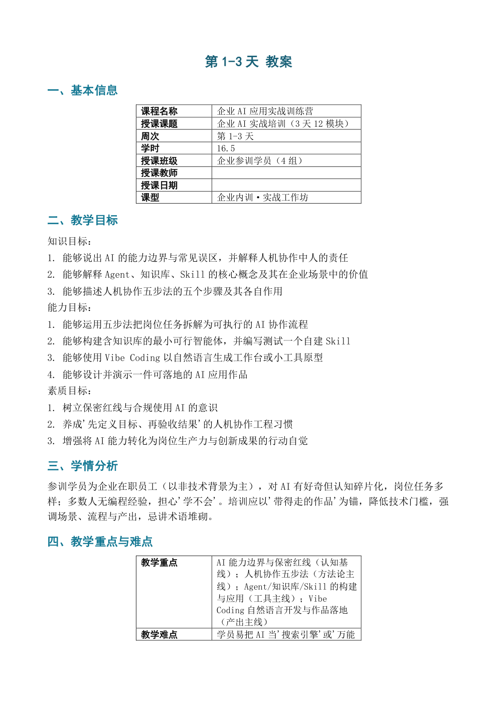

# 参考教案示例（reference-lesson）

这份示例回答一个具体问题：**教师手里已经有一份写得不错的教案（不是空模板），能不能直接拿它当版式来源？**

`参考教案_3天培训.docx` 就是这样的文件——已填好内容的三天企业 AI 培训教案，结构是：

```text
标题 → 一、基本信息（2 列表格）
     → 二、教学目标（编号段落，三组目标）
     → 三、学情分析（段落）
     → 四、教学重点与难点（2 列表格）
     → 五、教学方法与教学资源（2 列表格）
     → 六、教学过程（【课前】/【课中】/【课后】标记 + 7 组「环节标题 + 独立四维小表」）
     → 七、教学反思（3 行表格）
```

## 它和 `school-template` 的区别

| | school-template | reference-lesson |
|---|---|---|
| 样本状态 | 空白待填 | 已填好内容 |
| 环节表结构 | 一张表 N 行 | 每个环节一张独立小表 |
| 处理方式 | 行克隆/裁剪 | **单元配对/克隆/裁剪**（`mode: "units"`） |
| 教学目标 | 表格单元 | **编号段落区间**（`paragraph_range`） |

两处结构差异都由脚本自动识别，映射文件里能看到 `mode: "units"` 与 `kind: "paragraph_range"`。

## 生成结果

```bash
python scripts/analyze_template.py \
  --template examples/reference-lesson/参考教案_3天培训.docx \
  --out-dir examples/reference-lesson

python scripts/lesson_assistant.py --json examples/ai_training/lesson.json \
  --output-dir examples/reference-lesson \
  --template examples/reference-lesson/参考教案_3天培训.docx \
  --template-map examples/reference-lesson/参考教案_3天培训_template-map.json
```

成品：`第1-3天_企业AI实战培训（3天12模块）_教案.docx`，4 页，与原件的页数、表格宽度、字体字号、编号格式一致。



## 这份映射做了两处人工调整

1. `key_points` / `difficult_points` / `methods` / `resources` 加了 `"joiner": "；"`——原件里这四项是一整段连续文字，不是分条列表；
2. `objectives.all` 指向编号段落区间，生成时补上「知识目标／能力目标／素质目标」三个小标签。

第 2 点意味着**输出比原件多了 3 行标签**。原件三组目标都没有标签，脚本无法判断分组边界，只能整体替换并补标签。如果学校要求严格逐行一致，请在原件里补上分组标签后重新解析——解析器会按标签分别映射。

## 边界

- 参考教案的内容会被**整体替换**，不要直接拿原件的正式文件当样本，先复制一份；
- 单元数量与数据一致时只替换不增删；不足则克隆最后一组，多余则整组删除（含标题段）；
- 教学目标若是「无标签的纯编号列表」，只能整体替换并补标签，无法还原原始分组。
